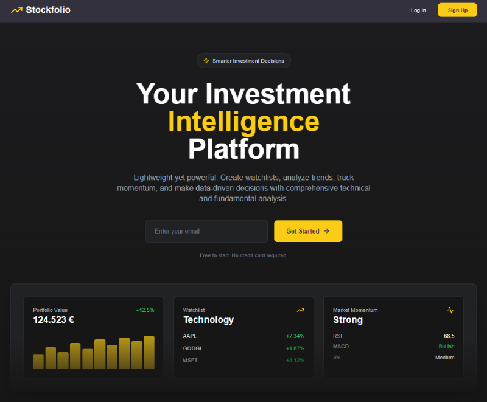

# Stockfolio



**Stockfolio** is a lightweight, responsive web tool designed to support smarter investment decisions. It allows users to create customized stock watchlists, analyze trends, and gain actionable insights using technical and fundamental financial metrics.

Built with modern web technologies, Stockfolio delivers a seamless and fast user experience for retail investors, traders, and financial enthusiasts.

---

## Features

- **Custom Watchlists** – Track selected stocks in a personalized view  
- **Technical Analysis** – Trend, momentum, and volatility breakdowns  
- **Fundamental Data** – Access to earnings, profit, and other key financial indicators  
- **Global Market Overview** – Snapshot of major stock exchanges  
- **Responsive UI** – Fast-loading, mobile-friendly interface

---

## Tech Stack

- **React** – Frontend UI components  
- **Next.js** – Server-side rendering and routing  
- **TypeScript** – Type safety across the codebase  
- **Tailwind CSS** – Utility-first styling  
- **MongoDB** – NoSQL database for storing user data & financial metrics  
- **Vite** – Fast dev environment setup (with Next.js)  
- **Alpha Vantage API** – Real-time and historical financial data

---

## Environment Variables

Before running the app, you’ll need to set up a `.env.local` file in the root directory with the following variables:

```env
MONGO_URL=your_mongodb_connection_string
DATABASE=your_database_name
ALPHA_VANTAGE_KEY=your_alpha_vantage_api_key
NEXT_PUBLIC_BASE_URL=http://localhost:3000
```

`MONGO_URL` is a server-only runtime requirement for authentication and database operations. MongoDB connections are initialized on the first database request, so `npm run build` does not require a database connection. For Vercel deployments, configure `MONGO_URL` and `DATABASE` for the environment being deployed (Preview or Production); a successful build alone does not verify database access.

### Alpha Vantage API

Stockfolio uses the [Alpha Vantage API](https://www.alphavantage.co/) throughout the app to fetch real-time stock data, historical prices, technical indicators, and more.

To use this app, you’ll need to:

1. Create a free account at [Alpha Vantage](https://www.alphavantage.co/support/#api-key)
2. Generate your API key
3. Configure it in `.env.local` or your deployment environment as the server-only `ALPHA_VANTAGE_KEY`. It is used by both fundamentals and the existing economics refresh. Do not use the former `NEXT_PUBLIC_ALPHA_VANTAGE_KEY` name: public Next.js variables are included in browser bundles. There is no fallback to that public variable. Configure the private variable before deploying this change; the application code does not change or rotate the key value.

Fundamentals requests use the existing NextAuth session through `/api/fundamentals`. Only the four supported data functions and a validated stock symbol are accepted. Provider failures return generic errors without provider URLs or credentials. See [SF-02](docs/security/SF-02.md) for the exposure proof, provider usage assumptions, and remaining account checks.

---

## Getting Started

To run the project locally, follow these steps:

### 1. Clone the repository

```bash
git clone https://github.com/your-username/stockfolio.git
cd stockfolio
```

### 2. Install dependencies

```bash
npm install
# or
yarn install
```

### 3. Set up environment variables

Create a `.env.local` file and add your configuration as shown above.

### 4. Start the development server

```bash
npm run dev
# or
yarn dev
```

Open [http://localhost:3000](http://localhost:3000) in your browser to view the app.

---

## License

This project is licensed under the [MIT License](LICENSE).
